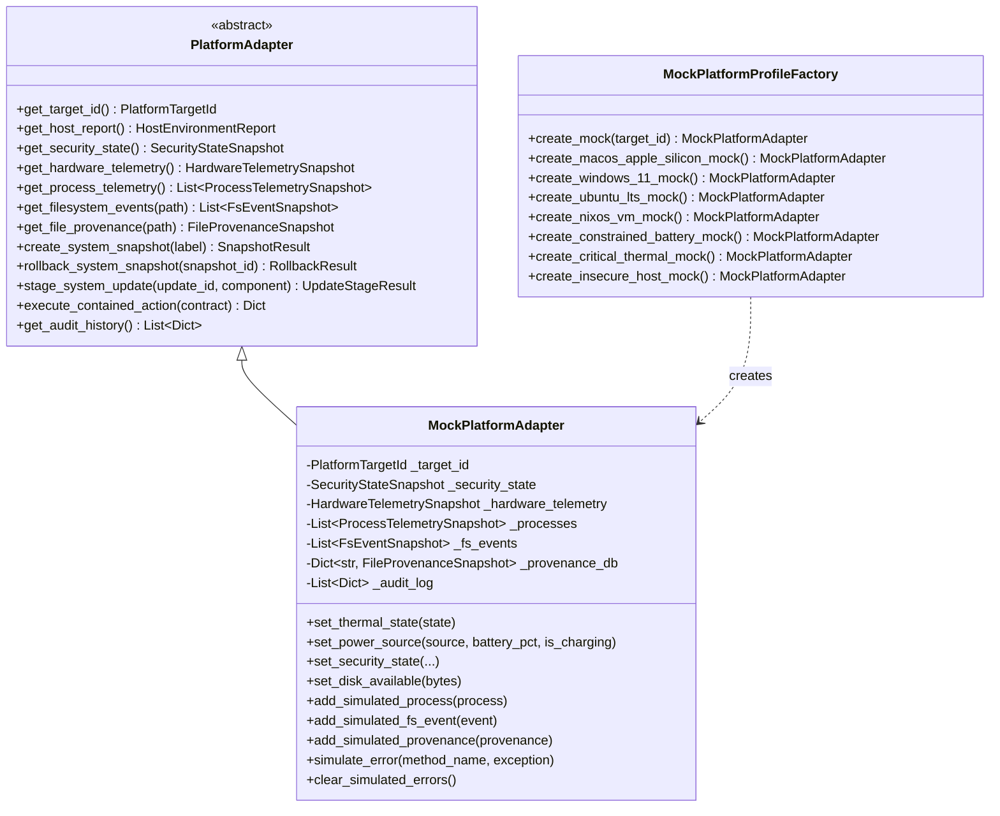

# Design Note — Day 039: Safe Mock-Platform Adapter for Development

**Day:** 039  
**Milestone:** 3 — Repository and development foundation (Days 026–040)  
**Status:** Approved & Implemented  
**Date:** 2026-11-16  
**Author:** SYSTEM MIND X Engineering Agent  
**Relevant ADR:** ADR-049  

---

## 1. Executive Summary & Context

SYSTEM MIND X is architected as an AI-native universal computer operator and governance platform. In Milestone 4 (Days 041–065), the platform begins detailed telemetry collection and system operations on native macOS (Darwin kernel, SIP, APFS snapshots, hardware thermal sensors, launchd daemons, TCC permissions).

Per repository architectural rules and safety principles:
- **Rule of Isolation:** "Start with read-only collection and mock adapters. Never modify the developer's host macOS, firmware, bootloader, partition map, firewall, startup services, system extensions or security settings unless the user explicitly approves the exact operation after seeing the plan."
- **Deterministic Evaluation:** "The deterministic policy engine must be independent of LLM judgement. Maintain platform adapters; never assume macOS, Windows and Linux APIs are interchangeable."
- **Pre-Privilege Simulation:** "Implement mock adapters before privileged platform actions."

Day 039 establishes the authoritative **Mock Platform Adapter** subsystem. It introduces:
1. The abstract base interface `PlatformAdapter` defining typed capability contracts across all 8 capability domains in `CapabilityDomain`.
2. The concrete, fully deterministic `MockPlatformAdapter` capable of emulating all 4 target platforms (`MACOS_APPLE_SILICON`, `WINDOWS_11_X64`, `UBUNTU_LTS_X64`, `NIXOS_VM`) with zero ambient shell execution and zero host mutation.
3. Configurable state simulation (thermal pressure levels, AC/battery power transitions, SIP/Gatekeeper toggles, storage exhaustion, filesystem events, quarantined downloads).
4. Safety invariant enforcement: autonomous maintenance attempts against user-managed applications or critical unapproved actions are rejected and audited.
5. The `MockPlatformProfileFactory` providing pre-configured profiles for developer workflows, chaos testing, and CI validation.
6. Developer CLI tool `tools/mock_platform_cli.py` and programmatic validator `MockPlatformValidator`.

---

## 2. Architecture & Domain Contracts

The `PlatformAdapter` ABC declares typed contracts aligned with the 8 capability domains established in Day 015 (`CapabilityDomain`):



### 2.1 Capability Domain Alignment

| Capability Domain | Method Signature | Simulated Native Behavior |
|:---|:---|:---|
| `HOST_INSPECTION` | `get_host_report()` | OS release, kernel version, CPU cores, RAM, toolchain paths |
| `SECURITY_AUTHORITY` | `get_security_state()` | SIP, Gatekeeper, Secure Boot, Firewall, FileVault, Lockdown mode |
| `HARDWARE_TELEMETRY` | `get_hardware_telemetry()` | CPU load, memory RSS/free, thermal level, AC/battery metrics |
| `PROCESS_TELEMETRY` | `get_process_telemetry()` | Process list with PID, PPID, ownership flags, code signature status |
| `FS_OBSERVATION` | `get_filesystem_events(path)` | Simulated FSEvents / USN / fanotify stream with path, event type, timestamp |
| `FILE_PROVENANCE` | `get_file_provenance(path)` | Quarantine xattrs, Zone.Identifier, SHA-256 digest, download origin URL |
| `SYSTEM_SNAPSHOT_ROLLBACK` | `create_system_snapshot()` / `rollback_system_snapshot()` | APFS snapshot / VSS shadow copy creation and non-destructive revert |
| `SYSTEM_PACKAGE_MAINTENANCE`| `stage_system_update()` | Autonomous system core patching vs strictly blocked user app patching |
| `EXECUTION_CONTAINMENT` | `execute_contained_action()` | Typed ActionContract execution inside synthetic sandbox boundary |

---

## 3. Safety Invariants & Guardrails

1. **Zero Host Side-Effects (SC-01):**
   - The mock platform adapter runs completely in memory. It makes zero system calls to `/bin/sh`, zero subprocess calls to native OS management commands (`diskutil`, `tmutil`, `csrutil`, `launchctl`, `systemctl`), and writes zero state outside user-specified scratch buffers.
2. **User Application Protection (SC-02 / ADR-018):**
   - If an action contract targets `ComponentOwnership.USER_MANAGED` and is flagged as `is_autonomous_maintenance`, `MockPlatformAdapter.execute_contained_action()` immediately raises a security rejection and logs the incident.
3. **Privileged Escalation Guard (SC-03):**
   - Actions marked `OperationRiskTier.CRITICAL_PRIVILEGED` or requiring root privileges must have `user_approved: True`. In unapproved state, the mock adapter rejects execution.
4. **Audit Trail Completeness:**
   - Every mutating mock call (`set_thermal_state`, `create_system_snapshot`, `rollback_system_snapshot`, `stage_system_update`, `execute_contained_action`) appends an immutable JSON record to `_audit_log` with timestamp, action type, target component, and result.

---

## 4. Developer CLI Tool (`tools/mock_platform_cli.py`)

The mock platform CLI provides developers and automated pipelines an instant command-line tool to inspect and validate simulated platforms:

```bash
# Inspect simulated macOS Apple Silicon host
python3 tools/mock_platform_cli.py inspect --target MACOS_APPLE_SILICON

# Output hardware and process telemetry as JSON
python3 tools/mock_platform_cli.py telemetry --target WINDOWS_11_X64 --json

# Run matrix compatibility audit across all 4 targets
python3 tools/mock_platform_cli.py audit-matrix
```

---

## 5. Verification Matrix

The test suite (`tests/test_mock_platform_adapter.py`) covers:
1. `PlatformAdapter` ABC completeness and adherence.
2. `MockPlatformAdapter` instantiation across all 4 target platforms (`MACOS_APPLE_SILICON`, `WINDOWS_11_X64`, `UBUNTU_LTS_X64`, `NIXOS_VM`).
3. Simulated state mutations (thermal escalation, power source changes, disk space exhaustion).
4. Process and filesystem event injection and query filtering.
5. File quarantine and provenance tracking.
6. System snapshot creation and rollback life cycle.
7. System package maintenance boundaries (system core permitted, user applications blocked).
8. Critical action approval gates and rejection paths.
9. Error simulation and fault injection (`simulate_error`).
10. `MockPlatformProfileFactory` preset profile correctness.
11. `MockPlatformValidator` repository audit clean pass.
12. `tools/mock_platform_cli.py` CLI dry-run and command execution.
