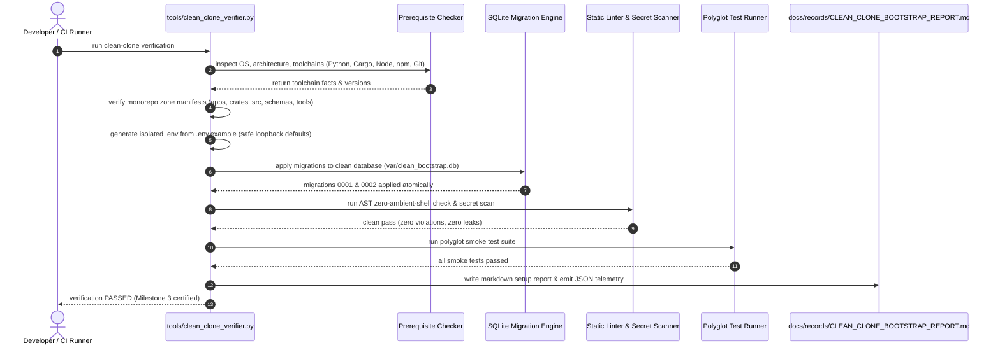

# Design Note — Day 040: Clean-Clone Bootstrap Verification and Setup Telemetry

**Day:** 040  
**Milestone:** 3 — Repository and development foundation (Days 026–040) [FINAL DAY]  
**Status:** Approved & Implemented  
**Date:** 2026-11-16  
**Author:** SYSTEM MIND X Engineering Agent  
**Relevant ADR:** ADR-050  

---

## 1. Executive Summary & Context

Day 040 marks the conclusion and capstone of **Milestone 3: Repository and development foundation** (Days 026–040). Over the past fifteen days, SYSTEM MIND X established a polyglot monorepo layout, strict package boundaries, a Rust workspace, Tauri desktop presentation shell, React/TypeScript console, multi-language static analysis, a polyglot test framework, secret masking primitives, structured JSON logging, SQLite migrations, developer setup scripts, CI pipelines with dependency auditing, and a safe mock platform adapter.

The objective of Day 040 is to verify that a completely clean clone of the repository can be bootstrapped from scratch in an unprivileged developer environment with zero ambient shell elevation, zero sudo operations, and 100% deterministic reproducibility.

Day 040 establishes:
1. **The Clean-Clone Verifier Tool (`tools/clean_clone_verifier.py`):** An automated verification utility that executes an isolated clean-clone bootstrap sequence, measures step-by-step latency, validates toolchains, tests database migration, runs static analysis and smoke tests, and emits machine-readable JSON telemetry.
2. **Authoritative Setup Results Record (`docs/records/CLEAN_CLONE_BOOTSTRAP_REPORT.md`):** Comprehensive documentation of real host telemetry (Apple Silicon macOS), prerequisite checks, execution durations, database integrity, and Milestone 3 readiness sign-off.
3. **Packaging Validator (`src/system_mind/packaging/clean_bootstrap.py`):** Programmatic validator auditing setup report completeness, verifier CLI functionality, and zero-privileged execution compliance in CI.
4. **Architectural Decision Record (ADR-050):** Formally freezing Milestone 3 foundations and certifying clean-clone reproducibility prior to beginning Milestone 4 (macOS system agent and telemetry, Days 041–065).

---

## 2. Clean-Clone Bootstrap Lifecycle



---

## 3. Verification Criteria & Invariants

1. **Unprivileged Execution (SC-01 / INV-BOOT-01):**
   - The entire bootstrap process runs strictly in user space without `sudo`, administrator entitlements, or host OS modification.
2. **Zero Ambient Shell Authority (SC-01 / INV-BOOT-02):**
   - All internal processes dispatch via tokenized argument lists (`subprocess.run(["..."])`, no `shell=True`).
3. **Hermetic Isolation (INV-BOOT-03):**
   - The verifier executes against a dedicated temporary or isolated database path without contaminating or corrupting developer working databases.
4. **Telemetry Completeness (INV-BOOT-04):**
   - Real command exit codes, execution wall-clock durations, host architecture details, and git commit references are captured and recorded truthfully.
5. **Milestone 3 Exit Gate Certification (INV-BOOT-05):**
   - All 15 days of Milestone 3 (Days 026–040) verified and frozen:
     - Day 026: Monorepo layout & zone boundaries
     - Day 027: Unified developer tooling
     - Day 028: Python packaging & CLI
     - Day 029: Rust workspace & crates (`common`, `sensors`, `broker`)
     - Day 030: Tauri desktop presentation shell
     - Day 031: React/TypeScript frontend scaffold
     - Day 032: Code formatting, linting & AST safety
     - Day 033: Polyglot test pyramid & orchestrator
     - Day 034: Environment config & secret masking
     - Day 035: Structured JSON logging & redaction
     - Day 036: SQLite transactional migrations
     - Day 037: Local development setup & wrappers
     - Day 038: CI matrix & supply-chain reviewer
     - Day 039: Safe mock platform adapter
     - Day 040: Clean-clone bootstrap verification

---

## 4. Developer CLI Tool (`tools/clean_clone_verifier.py`)

```bash
# Run full clean-clone bootstrap verification and update report
python3 tools/clean_clone_verifier.py

# Preview verification stages without mutating state
python3 tools/clean_clone_verifier.py --dry-run

# Output machine-readable JSON telemetry
python3 tools/clean_clone_verifier.py --json
```
