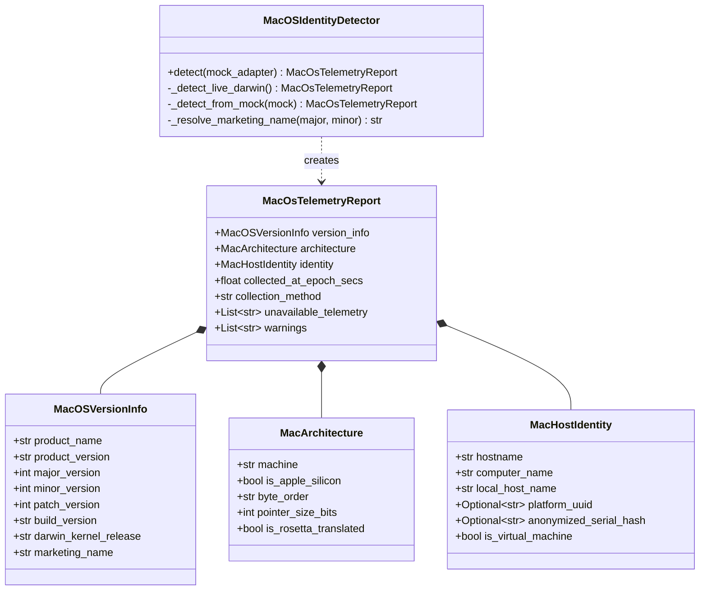

# Design Note — Day 041: macOS Version, Build, Architecture and Host Identity Detection

**Day:** 041  
**Milestone:** 4 — macOS system agent and telemetry (Days 041–065) [KICKOFF]  
**Status:** Approved & Implemented  
**Date:** 2026-11-16  
**Author:** SYSTEM MIND X Engineering Agent  
**Relevant ADR:** ADR-051  

---

## 1. Executive Summary & Context

Milestone 4 begins the implementation of the read-only **macOS System Agent and Telemetry Collection** layer (Days 041–065). Under the SYSTEM MIND X product charter:
- **Tier 1 Companion Target:** macOS on Apple Silicon (M1/M2/M3/M4) is the primary development host and host companion.
- **Read-Only Non-Privileged First:** "Start with read-only collection and mock adapters. Never modify the developer's host macOS, firmware, bootloader, partition map, firewall, startup services, system extensions or security settings unless the user explicitly approves the exact operation after seeing the plan."
- **Unsupported Platform Transparency:** If a platform API or entitlement is unavailable, report a graceful unsupported/partial capability state; do not bypass OS protections.

Day 041 implements the core identity detection layer for macOS:
1. **Operating System Version & Build Detection:** Product name, product version (e.g., `15.1.0`), Darwin kernel release (e.g., `24.1.0`), build version (e.g., `24B83`), and marketing name mapping (`Sequoia`, `Sonoma`, `Ventura`, `Monterey`, `Big Sur`).
2. **Hardware Architecture & Rosetta 2 Verification:** Machine architecture (`arm64`), native Apple Silicon vs x86_64 classification, pointer size (64-bit), byte order, and Rosetta 2 translation status (`sysctl.proc_translated`).
3. **Host Identity & Privacy-Preserving Metadata:** Hostname, local hostname, computer name, platform UUID (`IOPlatformUUID`), and anonymized cryptographic SHA-256 fingerprinting of hardware serial numbers to ensure zero private serial leakage.
4. **Cross-Language Telemetry:** Rust sensor collector in `crates/system-mind-sensors` and Python models/detector in `src/system_mind/macos/`.
5. **Developer Tooling & Programmatic Packaging Validator:** CLI tool `tools/detect_macos.py` and validator `MacOsTelemetryValidator`.

---

## 2. Architecture & Domain Models



### 2.1 Native Darwin Detection Sources

| Telemetry Property | Primary Native Source | Fallback Source | Permission Level |
|:---|:---|:---|:---|
| **Product Version** | `/System/Library/CoreServices/SystemVersion.plist` | `sw_vers -productVersion` / `platform.mac_ver()` | Unprivileged Read |
| **Build Version** | `/System/Library/CoreServices/SystemVersion.plist` (`ProductBuildVersion`) | `sw_vers -buildVersion` / `sysctl kern.osversion` | Unprivileged Read |
| **Darwin Kernel** | `sysctl -n kern.osrelease` | `platform.release()` / `uname -r` | Unprivileged Read |
| **Silicon Architecture** | `sysctl -n hw.machine` | `platform.machine()` | Unprivileged Read |
| **Rosetta 2 Translation** | `sysctl -n sysctl.proc_translated` | `False` (if sysctl unavailable) | Unprivileged Read |
| **Computer Name** | `scutil --get ComputerName` | `socket.gethostname()` | Unprivileged Read |
| **Local Host Name** | `scutil --get LocalHostName` | `socket.gethostname()` | Unprivileged Read |
| **Platform UUID** | `ioreg -rd1 -c IOPlatformExpertDevice` (`IOPlatformUUID`) | `uuid.getnode()` derived | Unprivileged Read |
| **Serial Anonymization**| `ioreg -rd1 -c IOPlatformExpertDevice` (`IOPlatformSerialNumber`) | SHA-256 salted digest | Unprivileged Read |

---

## 3. Privacy & Safety Invariants

1. **Zero Privileged Calls (SC-01):**
   - Detection relies strictly on standard read-only POSIX APIs, sysctl reads, and non-privileged tool queries (`sw_vers`, `scutil`, `ioreg`). No command executes with `sudo` or administrator privileges.
2. **Hardware Serial Number Anonymization:**
   - Raw hardware serial numbers are never emitted in plaintext across logs, telemetry records, or reports. Telemetry models emit a truncated SHA-256 digest (`serial_hash[:12]...`) to provide tamper-evident host identity while preventing device fingerprint exfiltration.
3. **Graceful Non-Darwin Degradation:**
   - When executed on Linux, Windows, or within CI containers, `MacOSIdentityDetector` falls back to `MockPlatformAdapter` or returns a report explicitly listing native Darwin capabilities under `unavailable_telemetry`.
4. **Zero Ambient Shell Authority (SC-01):**
   - In accordance with SC-01, commands executed via subprocess use tokenized argument lists (`shell=False`) with strict timeouts and error handling.

---

## 4. Developer CLI Tool (`tools/detect_macos.py`)

```bash
# Detect live macOS host telemetry
python3 tools/detect_macos.py

# Output formatted JSON report
python3 tools/detect_macos.py --json

# Run in mock mode (simulating Apple Silicon macOS on any host)
python3 tools/detect_macos.py --mock --json
```

---

## 5. Verification Matrix

The test suite (`tests/test_macos_identity_detector.py`) covers:
1. Live host macOS detection (when on Darwin).
2. Mock macOS detection across arbitrary hosts.
3. Marketing name resolution for all modern macOS releases.
4. Apple Silicon vs Intel architecture classification.
5. Rosetta 2 translation flag parsing.
6. Serial number anonymization invariant (no plaintext serial in output).
7. Non-Darwin graceful fallback with `unavailable_telemetry` population.
8. Developer CLI tool execution and JSON serialization.
9. Packaging validator clean audit pass (`MacOsTelemetryValidator.audit()`).
10. Rust crate sensor integration in `crates/system-mind-sensors`.
