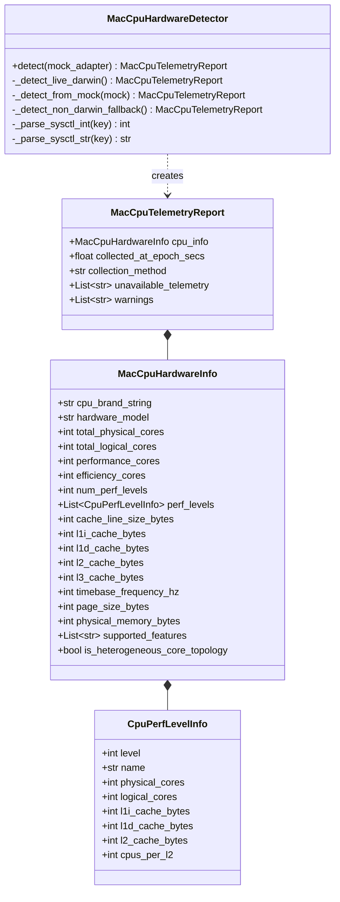

# Design Note — Day 042: macOS CPU Model, Core Counts and Supported Hardware Properties

**Day:** 042  
**Milestone:** 4 — macOS system agent and telemetry (Days 041–065)  
**Status:** Approved & Implemented  
**Date:** 2026-11-16  
**Author:** SYSTEM MIND X Engineering Agent  
**Relevant ADR:** ADR-052  

---

## 1. Executive Summary & Context

Day 042 expands the read-only macOS companion agent telemetry capabilities by capturing the host central processing unit (CPU) model, core topology (physical, logical, and heterogeneous Performance vs. Efficiency core clusters), cache hierarchy, memory bus characteristics, and supported hardware features.

### 1.1 Architectural Thesis & Boundaries
- **Charter Compliance (SC-01):** The AI control plane requires high-fidelity knowledge of the host compute topology to schedule reasoning tasks, evaluate thermal overhead, and govern resource consumption. However, all hardware introspection must remain strictly read-only and unprivileged.
- **Heterogeneous Silicon Architecture:** Apple Silicon processors (M1/M2/M3/M4 series) diverge fundamentally from symmetric x86 architectures by employing asymmetric hybrid core configurations (Performance "P-cores" and Efficiency "E-cores") with dedicated L2 cache clusters per performance tier.
- **Unsupported Platform Transparency:** When running on non-Darwin platforms (Linux, Windows) or uncertified virtualized CI environments, the system must report explicit unavailable telemetry properties rather than failing silently or hallucinating synthetic hardware values.

---

## 2. Architecture & Data Contracts



### 2.1 Native Darwin Hardware Introspection Sources

Introspection uses non-privileged Darwin `sysctl` interfaces:

| Telemetry Property | Native Sysctl Key | Sample M1 Value | Permission Level |
|:---|:---|:---|:---|
| **CPU Brand String** | `machdep.cpu.brand_string` | `"Apple M1"` | Read-Only User |
| **Hardware Model** | `hw.model` | `"MacBookAir10,1"` | Read-Only User |
| **Total Physical Cores**| `hw.physicalcpu` | `8` | Read-Only User |
| **Total Logical Cores** | `hw.logicalcpu` | `8` | Read-Only User |
| **Performance Levels** | `hw.nperflevels` | `2` (P + E) | Read-Only User |
| **P-Core Count** | `hw.perflevel0.logicalcpu` | `4` | Read-Only User |
| **P-Core Name** | `hw.perflevel0.name` | `"Performance"` | Read-Only User |
| **E-Core Count** | `hw.perflevel1.logicalcpu` | `4` | Read-Only User |
| **E-Core Name** | `hw.perflevel1.name` | `"Efficiency"` | Read-Only User |
| **Cache Line Size** | `hw.cachelinesize` | `128` bytes | Read-Only User |
| **Page Size** | `hw.pagesize` | `16384` bytes | Read-Only User |
| **Timebase Frequency** | `hw.tbfrequency` | `24000000` (24MHz) | Read-Only User |
| **Physical Memory** | `hw.memsize` | `8589934592` (8GB) | Read-Only User |
| **SIMD / Vector Feats**| `hw.optional.neon`, `hw.optional.floatingpoint` | `1`, `1` | Read-Only User |
| **ARM Architecture Feats**| `hw.optional.arm.FEAT_*` | `FEAT_CRC32`, `FEAT_AES`, `FEAT_SHA256` | Read-Only User |

---

## 3. Privacy, Safety & Confinement Invariants

1. **Zero Privileged Escalation (SC-01 / `INV-CPU-01`):**
   Introspection runs completely in user space without `sudo`, root, or administrator privileges. Queries execute via POSIX `sysctl` or tokenized subprocess vectors (`shell=False`).
2. **Zero Ambient Shell Authority (SC-01 / `INV-CPU-02`):**
   All subprocess calls dispatch with exact parameter vectors, bounded timeouts (5s), and strict error handling.
3. **Graceful Non-Darwin Degradation (`INV-CPU-03`):**
   On non-Darwin hosts (Linux/Windows CI runners), the detector delegates to `MockPlatformAdapter` or returns a structured report listing unsupported Darwin sysctls under `unavailable_telemetry`.
4. **Topology Determinism (`INV-CPU-04`):**
   For Apple Silicon, `total_physical_cores == performance_cores + efficiency_cores` is mathematically verified; core asymmetry is explicitly surfaced via `is_heterogeneous_core_topology = True`.

---

## 4. Developer CLI Tool (`tools/detect_cpu.py`)

The developer CLI provides instant inspection of CPU topology and hardware properties:

```bash
# Live inspection
python3 tools/detect_cpu.py

# Machine-parsable JSON output
python3 tools/detect_cpu.py --json

# Simulated Apple Silicon M1 environment
python3 tools/detect_cpu.py --mock --json

# Strict Apple Silicon assertion
python3 tools/detect_cpu.py --strict-apple-silicon
```

---

## 5. Polyglot Integration Matrix

- **Python Control Plane:** `src/system_mind/macos/cpu_models.py`, `src/system_mind/macos/cpu_detector.py`.
- **Packaging & CI Validator:** `src/system_mind/packaging/macos_cpu.py` (`MacOsCpuValidator`).
- **Rust Sensors Crate:** `crates/system-mind-sensors/src/macos_cpu.rs` (`MacOsCpuSnapshot`, `MacOsCpuCollector`, `MockMacOsCpuCollector`).
- **Test Suite:** `tests/test_macos_cpu_detector.py`.
