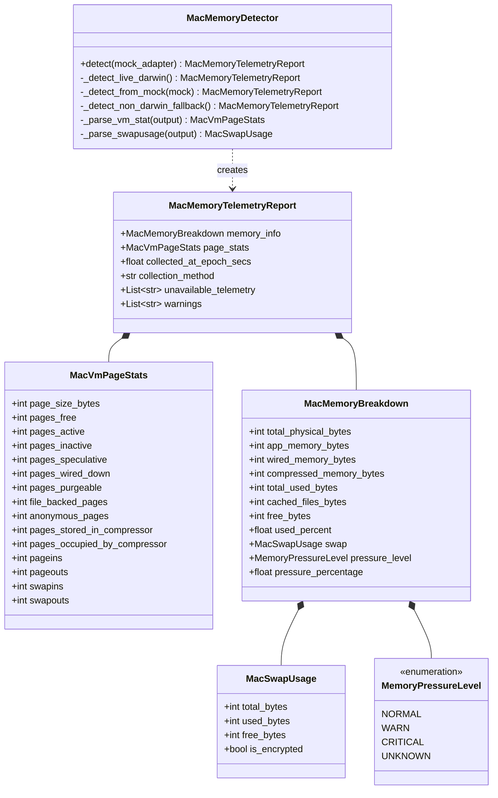

# Design Note — Day 043: macOS Memory Capacity, Pressure Indicators and Usage

**Day:** 043  
**Milestone:** 4 — macOS system agent and telemetry (Days 041–065)  
**Status:** Approved & Implemented  
**Date:** 2026-11-16  
**Author:** SYSTEM MIND X Engineering Agent  
**Relevant ADR:** ADR-053  

---

## 1. Executive Summary & Context

Day 043 implements the read-only **macOS Memory Capacity, Pressure Indicators, and Usage** telemetry subsystem. Memory telemetry is fundamental to the SYSTEM MIND X control plane:
- **Resource Governance:** Informs the cognitive planner whether memory pressure permits staging background maintenance, running local model inference, or caching digital twin snapshots.
- **Unified Memory Architecture on Apple Silicon:** On Apple Silicon M-series SoCs, system RAM is unified across CPU, GPU, and Neural Engine (NPU). Accurately categorizing Wired, Compressed, and App memory prevents thrashing.
- **Zero Mutating or Disruptive Actions:** Telemetry collection is purely passive and non-invasive. It uses standard Darwin `sysctl` and `vm_stat` queries. It strictly forbids synthetic pressure generators (e.g. `memory_pressure` without `-S` or allocation loops).

---

## 2. Architecture & Data Contracts



### 2.1 Native Darwin Memory Telemetry Sources

| Telemetry Property | Primary Source | Extraction Method | Permission Level |
|:---|:---|:---|:---|
| **Total Physical RAM** | `sysctl -n hw.memsize` | POSIX integer read | Read-Only User |
| **Virtual Page Size** | `vm_stat` header / `hw.pagesize` | 16,384 bytes on ARM64 | Read-Only User |
| **Mach VM Page Statistics** | `vm_stat` | Parses colon-delimited page counts | Read-Only User |
| **Swap Space & Encryption**| `sysctl vm.swapusage` | Regex `total = X used = Y free = Z (encrypted)` | Read-Only User |
| **Kernel Pressure Level** | `sysctl -n vm.memory_pressure` | 0=Normal, 1=Warn, 2=Critical | Read-Only User |
| **Memorystatus Pressure %** | `sysctl -n kern.memorystatus_level` | Integer percentage 0–100 | Read-Only User |

### 2.2 Mathematical Consistency Formulas

Following macOS Activity Monitor semantics:
1. $\text{App Memory} = (\text{anonymous\_pages} - \text{pages\_purgeable}) \times \text{page\_size}$
2. $\text{Wired Memory} = \text{pages\_wired\_down} \times \text{page\_size}$
3. $\text{Compressed Memory} = \text{pages\_occupied\_by\_compressor} \times \text{page\_size}$
4. $\text{Total Used Memory} = \text{App Memory} + \text{Wired Memory} + \text{Compressed Memory}$
5. $\text{Cached Files} = (\text{file\_backed\_pages} + \text{pages\_purgeable}) \times \text{page\_size}$
6. $\text{Free Memory} = \text{pages\_free} \times \text{page\_size}$

---

## 3. Safety & Confinement Invariants

1. **Zero Memory Allocation Testing (SC-01 / `INV-MEM-01`):**
   The companion agent never invokes memory stress testing or memory allocation probes (`memory_pressure` allocation flags). All telemetry is gathered via passive status queries.
2. **Zero Ambient Shell Authority (SC-01 / `INV-MEM-02`):**
   `vm_stat` and `sysctl` execute strictly with `shell=False`, exact argument lists, and bounded timeouts (5s).
3. **Mathematical Bounds Invariant (`INV-MEM-03`):**
   $0 \le \text{total\_used\_bytes} \le \text{total\_physical\_bytes}$ (except in synthetic or extreme paging edge cases, handled gracefully).
4. **Graceful Non-Darwin Fallback (`INV-MEM-04`):**
   On non-Darwin hosts, reports are synthesized via generic memory platform metrics or `MockPlatformAdapter`, recording unavailable Darwin sysctls under `unavailable_telemetry`.

---

## 4. Developer CLI Tool (`tools/detect_memory.py`)

```bash
# Live memory inspection
python3 tools/detect_memory.py

# Machine-parsable JSON output
python3 tools/detect_memory.py --json

# Simulated 8GB Apple Silicon mock environment
python3 tools/detect_memory.py --mock --json

# Fast threshold assertion
python3 tools/detect_memory.py --check-pressure
```
