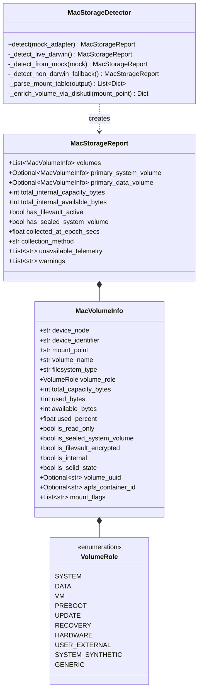

# Design Note — Day 044: macOS Storage Volumes, Capacity and Filesystem Metadata

**Day:** 044  
**Milestone:** 4 — macOS system agent and telemetry (Days 041–065)  
**Status:** Approved & Implemented  
**Date:** 2026-11-16  
**Author:** SYSTEM MIND X Engineering Agent  
**Relevant ADR:** ADR-054  

---

## 1. Executive Summary & Context

Day 044 implements the read-only **macOS Storage Volumes, Capacity and Filesystem Metadata** telemetry engine. In macOS on Apple Silicon, disk storage is structured around the Apple File System (APFS):
- **Signed System Volume (SSV):** The boot root filesystem (`/`) is cryptographically sealed with a SHA-256 Merkle tree and mounted read-only (`sealed, read-only`).
- **Volume Group Architecture:** APFS pairs the immutable System volume with a writable Data volume (`/System/Volumes/Data`) in an APFS Volume Group, sharing pooled container capacity.
- **FileVault Full-Disk Encryption:** User data volumes are encrypted at rest with hardware AES hardware support.
- **Resource Governance & Safe Updates:** Before staging any system update or digital twin snapshot, the control plane must verify available storage ($>15$ GB threshold) and verify that the target volume is not read-only immutable core.

---

## 2. Architecture & Data Contracts



### 2.1 Native Darwin Storage Introspection Sources

| Telemetry Property | Primary Source | Extraction Mechanism | Permission Level |
|:---|:---|:---|:---|
| **Mount Points & Flags** | `/sbin/mount` command | Whitespace and option parser | Read-Only User |
| **Capacity & Free Space** | POSIX `os.statvfs()` | `f_blocks * f_frsize`, `f_bavail * f_frsize` | Read-Only User |
| **Signed System Volume (SSV)** | `diskutil info /` | `Sealed: Yes` / mount flag `sealed` | Read-Only User |
| **FileVault Encryption** | `diskutil info /System/Volumes/Data` | `FileVault: Yes` | Read-Only User |
| **APFS Container ID** | `diskutil info <mount>` | `APFS Container: diskX` | Read-Only User |
| **SSD / Internal Media** | `diskutil info <mount>` | `Solid State: Yes`, `Device Location: Internal` | Read-Only User |

---

## 3. Privacy, Safety & Confinement Invariants

1. **Zero Destructive Storage Commands (SC-01 / `INV-STOR-01`):**
   The storage engine performs strictly read-only inspection. Destructive commands (`diskutil eraseVolume`, `diskutil partitionDisk`, `fdisk`, `newfs_apfs`, `umount`, `rm`) are permanently banned from runtime paths.
2. **Zero Ambient Shell Authority (SC-01 / `INV-STOR-02`):**
   `mount` and `diskutil` dispatch exclusively via tokenized argument lists (`shell=False`) with strict timeouts (5s).
3. **No Traversal of User Personal Data (`INV-STOR-03`):**
   Introspection inspects volume-level filesystem metadata only; it does not scan, index, or traverse personal user files, directories, or documents.
4. **Graceful Non-Darwin Fallback (`INV-STOR-04`):**
   When executed on non-Darwin platforms (Linux/Windows CI runners), the detector synthesizes a root volume via POSIX `statvfs('/')` or `MockPlatformAdapter`, recording Darwin APFS sysctls under `unavailable_telemetry`.

---

## 4. Developer CLI Tool (`tools/detect_storage.py`)

```bash
# Live storage inspection
python3 tools/detect_storage.py

# Machine-parsable JSON output
python3 tools/detect_storage.py --json

# Simulated Apple Silicon mock environment
python3 tools/detect_storage.py --mock --json

# Assert minimum required free space for system updates
python3 tools/detect_storage.py --check-free-space-gb 15.0
```
