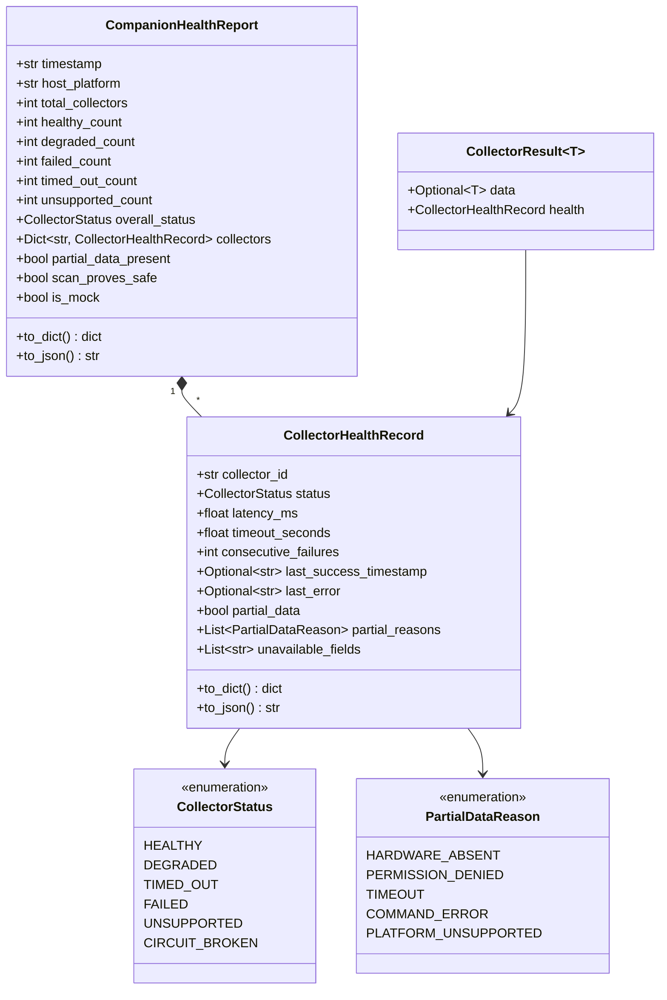
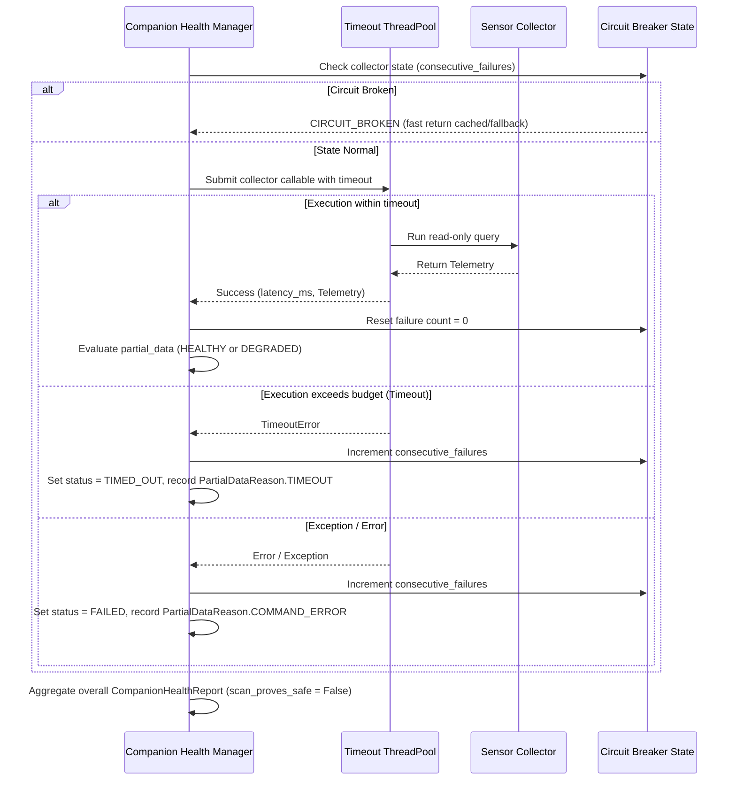

# Design Note: Day 057 — Collector Health, Timeout and Partial-Data Reporting

## 1. Architectural Scope & Context
SYSTEM MIND X orchestrates 16+ granular, non-privileged macOS telemetry detectors (identity, CPU, memory, storage, battery, network, GPU, USB, processes, launchd services, installed applications, code signatures, FSEvents, Endpoint Security feasibility, Swift companion bridge, and user agent launchd service).

In a production desktop companion agent, native OS telemetry collection faces real-world operational challenges:
1. **Subprocess & Syscall Latency / Hangs**: Slow disks, hung launchd queries, sysctl lockups, or deadlocked background processes can stall agent threads indefinitely if unmediated.
2. **Hardware Variance & Absent Peripherals**: Battery telemetry is absent on desktop Macs (Mac mini, Mac Studio, Mac Pro); external GPUs are absent on Apple Silicon; discrete GPUs are absent on MacBook Air.
3. **Permission Restrictions & Sandbox Gates**: Missing TCC permissions (Accessibility, Full Disk Access, Screen Recording) or lack of root/Endpoint Security entitlements cause partial data availability.
4. **Platform Boundary Invariance**: On non-Darwin hosts, Darwin-specific subsystems must fail gracefully with explicit `UNSUPPORTED` status rather than throwing unhandled exceptions.

Day 057 introduces the **Collector Health, Timeout, and Partial-Data Reporting Subsystem** to provide deterministic timeout enforcement, health state tracking, circuit breaking, and structured partial-data reporting across all telemetry collectors.

---

## 2. Invariants & Safety Constraints

### SC-01: Zero Ambient Shell Authority
All underlying detector operations execute strictly via tokenized argument vectors (`shell=False`) with strict timeouts (<= 3.0s). The health manager enforces per-collector latency budgets and never invokes shell interpreters.

### INV-HEALTH-01: Strict Per-Collector Timeout Containment
Every collector execution is wrapped in a strict timeout envelope (`timeout_seconds`, typically 1.0s – 3.0s). If execution exceeds this budget, the collector is terminated/abandoned, recorded as `TIMED_OUT`, and a typed fallback with `PartialDataReason.TIMEOUT` is returned immediately without blocking the orchestrator.

### INV-HEALTH-02: Circuit Breaker for Thrashing or Hung Collectors
If a collector fails or times out consecutively for `max_consecutive_failures` (default: 3), it transitions into `CollectorStatus.CIRCUIT_BROKEN`. Subsequent queries immediately return cached or partial fallback data without dispatching calls until a cooldown period elapses, preventing cascade starvation.

### INV-HEALTH-03: Explicit Partial-Data Categorization
When telemetry is incomplete, the system must not emit null values or silent omissions. Every partial telemetry payload must explicitly flag `partial_data = True` and categorize the exact reasons (`HARDWARE_ABSENT`, `PERMISSION_DENIED`, `TIMEOUT`, `COMMAND_ERROR`, `PLATFORM_UNSUPPORTED`) along with the list of `unavailable_fields`.

### INV-HEALTH-04: Non-Negotiable Charter Invariant: "Scan != Safe"
Collector health telemetry reflects data collection fidelity and system observability, not software safety. All health reports, records, and envelopes structurally enforce `scan_proves_safe = False`.

### INV-HEALTH-05: Deterministic Mock Simulation & Platform Fallback
On non-Darwin hosts or in headless CI test environments, the health manager gracefully yields deterministic mock profiles (`healthy`, `degraded`, `timeout`, `unsupported`) with zero ambient host dependencies.

---

## 3. Data Model Architecture

---

## 4. Execution Flow & Lifecycle

---

## 5. Implementation Roadmap
1. `src/system_mind/macos/collector_health_models.py`: Strongly typed enums, records, and report models.
2. `src/system_mind/macos/collector_health_manager.py`: Threaded timeout wrapper, circuit breaker state machine, and orchestrator.
3. `crates/system-mind-sensors/src/macos_collector_health.rs`: Rust sensor collector snapshot models and tests.
4. `tools/detect_collector_health.py`: Terminal CLI tool with color-coded health tables and `--json` support.
5. `src/system_mind/packaging/macos_collector_health.py`: Programmatic validator auditing models, timeout safety, and AST compliance.
6. `tests/test_macos_collector_health.py`: Full pytest unit/contract/integration suite.
7. ADR-067 in `docs/DECISION_LOG.md`.
