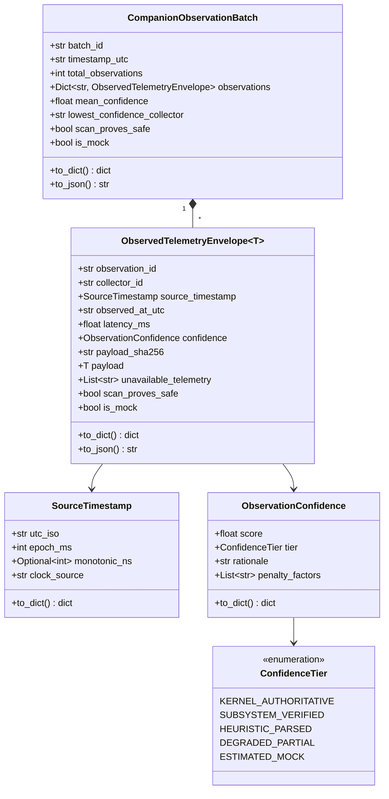

# Design Note: Day 058 — Source Timestamps and Confidence Scoring for Telemetry Observations

## 1. Architectural Scope & Context
In macOS companion telemetry collection, raw sensor data originates from multiple disparate sources:
- Kernel syscalls & sysctls (`sysctlbyname`, `host_processor_info`)
- Hardware subsystem registries (`IOKit`, `SMC`, `SPPowerDataType`)
- IPC daemons & system brokers (`launchd`, `EndpointSecurity.framework`, `NSWorkspace`)
- Developer CLIs & system utilities (`/bin/ps`, `/usr/bin/codesign`, `/bin/df`)
- Synthetic test fixtures and mock platform adapters

Prior art systems often make two critical errors:
1. **Wall-Clock Conflation**: Storing only the time the agent thread parsed the result rather than the timestamp when the underlying source/kernel produced the reading.
2. **Binary or Fabricated Trust**: Treating all collected data with identical certainty, or claiming that successful collection implies application safety ("Scan == Safe").

Day 058 introduces the **Observation Source Timestamping and Confidence Scoring Architecture** for SYSTEM MIND X, ensuring every telemetry record carries verifiable temporal provenance and a deterministic confidence rating reflecting source authority and completeness.

---

## 2. Invariants & Safety Constraints

### SC-01: Zero Ambient Shell Authority
All detector invocations execute via tokenized argument lists (`shell=False`) with strict timeouts (<= 3.0s). Clock readings query native Python/OS monotonic and UTC clocks without shell invocation.

### INV-OBS-01: Explicit Source Timestamping & Clock Source Provenance
Every observation must explicitly distinguish:
- `source_timestamp_utc`: Timezone-aware ISO-8601 string of when the reading was captured at the source.
- `source_timestamp_epoch_ms`: Milliseconds since UNIX epoch.
- `clock_source`: The clock source utilized (`"mach_continuous_time"`, `"sysctl.boottime"`, `"system_clock_utc"`, `"mock_clock"`).
- `latency_ms`: Duration elapsed between initiating collection and obtaining the result.

### INV-OBS-02: Deterministic Multi-Tier Confidence Scoring
Every observation is assigned a continuous confidence score in `[0.0, 1.0]` categorized into five deterministic tiers:
1. `KERNEL_AUTHORITATIVE` (0.95 – 1.00): Direct native kernel syscalls, IOKit registry, sysctl.
2. `SUBSYSTEM_VERIFIED` (0.80 – 0.94): Authorized macOS system services (`launchd`, `codesign`, `system_profiler`).
3. `HEURISTIC_PARSED` (0.60 – 0.79): Parsed CLI output or text pattern extraction with fallback.
4. `DEGRADED_PARTIAL` (0.40 – 0.59): Telemetry with missing attributes, missing hardware, or restricted entitlements.
5. `ESTIMATED_MOCK` (0.10 – 0.39): Synthetic mock fixtures or simulation test profiles.

### INV-OBS-03: Deterministic Penalty Deductions
Confidence scores start from a collector-specific baseline and apply explicit, auditable penalty deductions:
- Missing hardware / absent peripheral: -0.20
- Restricted permission / missing entitlement: -0.35
- Parsing fallback / degraded fields: -0.20
- Synthetic mock profile: -0.60
- Collection timeout / fallback data: -0.50

### INV-OBS-04: Cryptographic Payload Integrity
Every observation envelope computes `payload_sha256`, the deterministic SHA-256 digest over the canonical JSON representation of the observed telemetry state.

### INV-OBS-05: Non-Negotiable Charter Invariant: "Scan != Safe"
Observation confidence reflects measurement authority and data completeness, not software safety. All envelopes, records, and batch reports structurally enforce `scan_proves_safe = False`.

---

## 3. Data Model Architecture

---

## 4. Implementation Plan
1. `src/system_mind/macos/observation_models.py`: Strongly typed data models and confidence taxonomy.
2. `src/system_mind/macos/observation_engine.py`: Observation enrichment engine and batch aggregator.
3. `crates/system-mind-sensors/src/macos_observations.rs`: Native Rust sensor snapshots and tests.
4. `tools/detect_observations.py`: Developer CLI tool with formatted confidence inspection table.
5. `src/system_mind/packaging/macos_observations.py`: Packaging validator auditing models, timestamps, confidence scoring, and AST safety.
6. `tests/test_macos_observations.py`: Comprehensive test suite.
7. ADR-068 in `docs/DECISION_LOG.md`.
