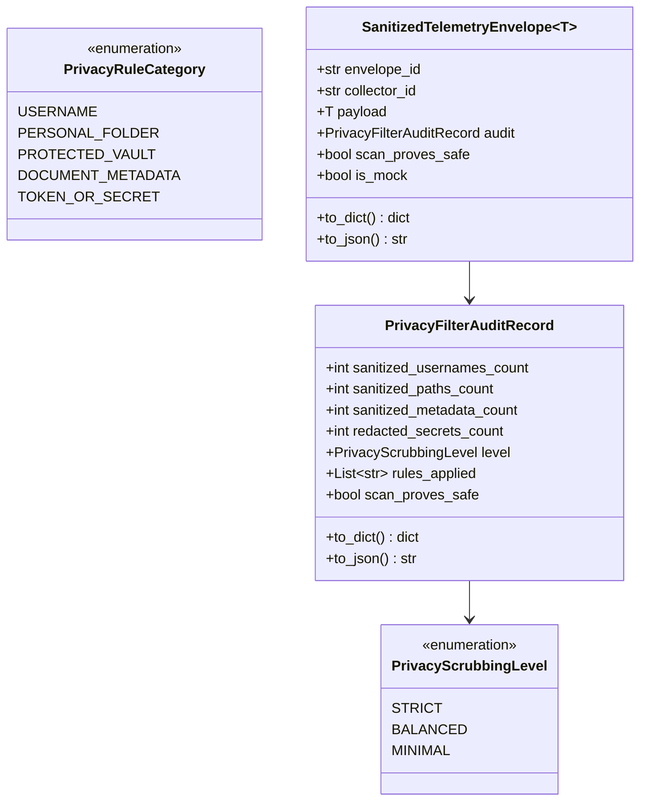

# Design Note: Day 059 — Privacy Filters for Paths, Usernames and Document Metadata

## 1. Architectural Scope & Context
In macOS companion telemetry collection, observed events capture rich runtime telemetry:
- **Process table & launchd specifications**: Execution paths, program arguments, environment variables.
- **Filesystem events (FSEvents)**: File creation, modification, and path notification streams.
- **Swift companion bridge & frontmost application**: Active application bundle path, window titles, user session.
- **Identity & user agent**: Active console username, user UID, user home directory (`/Users/<username>/`).

Without deterministic privacy filtering, raw telemetry streams can inadvertently leak:
1. **User Identity**: Plaintext local usernames (e.g., `tharungodwin`, `john.doe`) exposing personal identity.
2. **Personal Directory Hierarchies**: Sensitive user document directories (`~/Documents/`, `~/Desktop/`, `~/Downloads/`, `~/Pictures/`, `~/Music/`, `~/Movies/`).
3. **Protected Key Vaults & Configurations**: SSH keys (`~/.ssh`), cloud credentials (`~/.aws`, `~/.config/gcloud`), GPG keys (`~/.gnupg`), browser profiles and cookie stores (`~/Library/Application Support/Google/Chrome/`, `~/Library/Safari/`).
4. **Document Metadata & Window Titles**: Window titles disclosing active confidential documents or sensitive web page URLs.

Day 059 implements the **macOS Privacy Filter Engine** for SYSTEM MIND X, ensuring all emitted telemetry undergoes deterministic, multi-level privacy sanitization prior to digital-twin ingestion or persistence.

---

## 2. Invariants & Safety Constraints

### SC-01: Zero Ambient Shell Authority
All privacy sanitization functions operate purely as in-memory deterministic string and structured dictionary transformers. No external shell commands, utilities, or subprocesses are invoked.

### INV-PRIV-01: Deterministic Username Anonymization
All occurrences of local usernames (derived from system identity or matching `/Users/<username>/`) are transformed into deterministic, pseudonymized tokens (e.g. `user_7a8b` or `<REDACTED_USER>`). The pseudonym map remains consistent within an agent session to allow temporal event correlation without exposing the real identity.

### INV-PRIV-02: Scoped Path Sanitization & Vault Protection
File paths within protected personal roots are categorized and masked:
- `~/Documents/*` -> `~/<PROTECTED_DOCUMENTS>/<REDACTED_DOCUMENT>`
- `~/Desktop/*` -> `~/<PROTECTED_DESKTOP>/<REDACTED_FILE>`
- `~/Downloads/*` -> `~/<PROTECTED_DOWNLOADS>/<REDACTED_DOWNLOAD>`
- `~/Pictures/*`, `~/Music/*`, `~/Movies/*` -> `~/<PROTECTED_MEDIA>/<REDACTED_FILE>`
- `~/.ssh/*`, `~/.aws/*`, `~/.gnupg/*`, `~/.config/*` -> `~/<PROTECTED_KEY_VAULT>`
- System paths (`/System/`, `/Library/`, `/Applications/`, `/usr/bin/`) retain full path structure to preserve OS diagnosis fidelity.

### INV-PRIV-03: Document Metadata & Window Title Scrubbing
Window titles, command arguments, and application document titles containing confidential document patterns or web URLs are scrubbed of personal file names, query parameters, and auth tokens while preserving the executing application identifier.

### INV-PRIV-04: Non-Negotiable Charter Invariant: "Scan != Safe"
Privacy sanitization ensures data confidentiality, but does not certify software safety. All scrubbed telemetry envelopes, records, and reports structurally enforce `scan_proves_safe = False`.

### INV-PRIV-05: Auditable Privacy Transformation Metrics
Every privacy filtering pass produces an immutable `PrivacyFilterAuditRecord` logging the exact counts of sanitized usernames, masked paths, redacted tokens, and sanitized metadata strings.

---

## 3. Data Model Architecture

---

## 4. Implementation Plan
1. `src/system_mind/macos/privacy_models.py`: Strongly typed enums, audit records, and envelope models.
2. `src/system_mind/macos/privacy_filter.py`: Path, username, and document metadata filter engine.
3. `crates/system-mind-sensors/src/macos_privacy.rs`: Native Rust privacy filter snapshot models and tests.
4. `tools/detect_privacy_filter.py`: Developer CLI tool demonstrating before/after sanitization and metrics.
5. `src/system_mind/packaging/macos_privacy.py`: Packaging validator auditing models, privacy rules, and AST safety.
6. `tests/test_macos_privacy_filter.py`: Comprehensive test suite.
7. ADR-069 in `docs/DECISION_LOG.md`.
