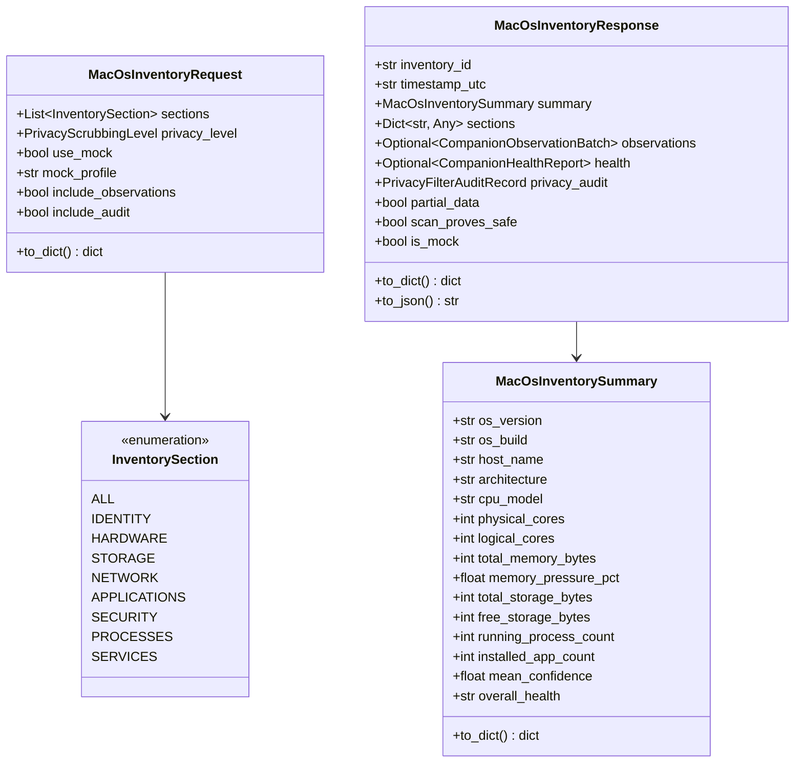

# Design Note: Day 060 — Read-Only macOS Inventory API

## 1. Architectural Scope & Context

Over Days 041 through 059, SYSTEM MIND X established seventeen specialized Darwin sensor collectors and telemetry engines covering:
- **Host & Hardware**: Identity (041), CPU (042), Memory (043), Storage (044), Battery (045), Network (046), GPU/Displays (047), USB/Peripherals (048).
- **Runtime Processes & Services**: Process table (049), Launchd services & login items (050).
- **Application Context**: Installed applications (051), Code signatures & Gatekeeper notarization (052).
- **Observational Signals**: FSEvents filesystem notifications (053), Endpoint Security feasibility (054), Swift companion bridge (055).
- **Execution & Quality Governance**: Least-privilege user agent service (056), Collector health & timeouts (057), Source timestamps & confidence scoring (058), and Privacy filtering & metadata scrubbing (059).

Prior to Day 060, consumers (the cognitive control plane, digital twin graph, desktop UI, or developer tools) had to invoke separate disparate collector methods, coordinate timeouts, calculate confidence penalties, and manually scrub privacy-sensitive fields.

Day 060 synthesizes these foundational collectors into a unified, strongly typed **Read-Only macOS Inventory API** (`MacOsInventoryApi`). The API aggregates system state into a holistic system snapshot, supports granular section querying, enforces end-to-end privacy sanitization, embeds source provenance and confidence metrics, and structurally guarantees read-only safety.

---

## 2. Invariants & Safety Constraints

### SC-01: Read-Only Query Semantics & Zero Ambient Shell
All inventory operations are strictly read-only (`is_mutating = False`). Any request attempting mutation, process termination, configuration changes, or root privilege escalation is rejected by contract. All subprocess collector queries maintain tokenized argument vectors (`shell=False`) with strict timeouts.

### INV-INV-01: Sectional Granularity & Lazy/Targeted Ingestion
Consumers can request the entire inventory (`InventorySection.ALL`) or target specific subsystems (`IDENTITY`, `HARDWARE`, `STORAGE`, `NETWORK`, `APPLICATIONS`, `SECURITY`, `PROCESSES`, `SERVICES`). This prevents unnecessary execution overhead when only a subset of system telemetry is required.

### INV-INV-02: End-to-End Privacy Sanitization
All emitted inventory payloads pass through the `MacPrivacyFilter` (Day 059) before leaving the API boundary. Usernames are deterministically pseudonymized, personal directories (`Documents`, `Desktop`, `Downloads`, `Pictures`, etc.) and key vaults (`.ssh`, `.aws`, `.gnupg`, Keychains) are masked, document filenames in window titles are redacted, and secrets are scrubbed according to the requested `PrivacyScrubbingLevel`.

### INV-INV-03: Temporal Provenance & Measurement Confidence
Every inventory response incorporates the `CompanionObservationBatch` (Day 058) capturing native clock source timestamps (`mach_continuous_time`, `sysctl.boottime`, `system_clock_utc`), per-subsystem latency, continuous confidence scores in `[0.0, 1.0]`, and explicit penalty factor deductions.

### INV-INV-04: Collector Health & Partial Data Transparency
The API integrates `CollectorHealthManager` (Day 057). If a specific collector times out, encounters permission denial, or fails, the API does not abort the entire inventory; instead, it marks `partial_data = True`, categorizes the failure reason (`TIMEOUT`, `PERMISSION_DENIED`, etc.), and returns partial data with graceful fallback fixtures.

### INV-INV-05: Non-Negotiable Charter Invariant: "Scan != Safe"
An exhaustive, high-confidence inventory represents system state and telemetry completeness, not application safety or maliciousness. All response envelopes structurally enforce `scan_proves_safe = False`.

---

## 3. Data Model Architecture

---

## 4. API Endpoints & Wire Protocol

The API adheres to Day 024 `ApiRequest` / `ApiResponse` conventions:
- Method URN: `urn:systemmind:macos:inventory:get`
  - Parameters: `sections`, `privacy_level`, `use_mock`
  - Mutating: `False`
- Method URN: `urn:systemmind:macos:inventory:summary`
  - Parameters: `use_mock`
  - Mutating: `False`

---

## 5. Implementation Roadmap
1. `src/system_mind/macos/inventory_models.py`: Strongly typed enums, request, summary, and response envelopes.
2. `src/system_mind/macos/inventory_api.py`: Aggregator engine, section filters, wire handler.
3. `crates/system-mind-sensors/src/macos_inventory.rs`: Native Rust inventory snapshot and provider traits.
4. `tools/detect_inventory.py`: Developer CLI utility for inspecting complete system inventories.
5. `src/system_mind/packaging/macos_inventory.py`: Programmatic validator auditing inventory contracts and safety.
6. `tests/test_macos_inventory_api.py`: Comprehensive test suite verifying all invariants, sections, privacy scrubbing, and error handling.
